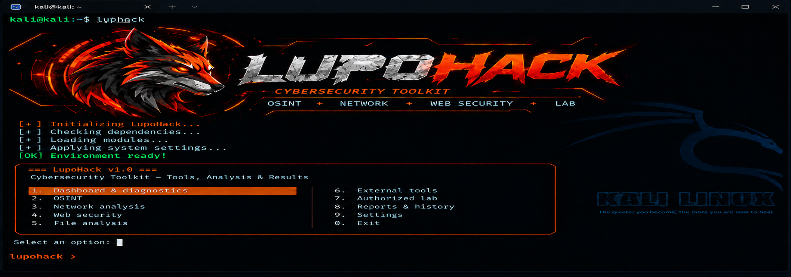

# LupoHack V1

LupoHack is a local, defensive cybersecurity toolkit for authorized diagnostics, public-information lookups, and local file analysis. It provides a command-line interface and an interactive terminal menu. It has no backend, online account, or telemetry. Use it only on systems, networks, files, and data you are authorized to access.



## Project status and scope

The V1 core includes environment diagnostics; DNS A, AAAA, MX, NS, TXT, and CNAME lookups; RDAP queries; TCP connectivity checks; limited HTTP(S) response-header inspection; local file hashes and metadata; local report history; JSON, CSV, and TXT export; and validated local JSON configuration.

Optional external-tool adapters cover Sherlock username searches, a single-host Nmap TCP-connect scan, and detection/version checks plus confirmation-gated local launches for OWASP ZAP and Metasploit Framework. Their real binaries were not installed or tested in the validation environment. A successful PATH check is not an end-to-end integration test. ZAP API/scanning and automated Metasploit modules, exploits, payloads, or targets are not part of LupoHack V1. **LupoHack is not a vulnerability scanner.**

DNS queries disclose the queried domain to the configured resolver. RDAP and web requests contact their corresponding public services. Sherlock queries public websites and does not establish that a profile belongs to a particular person. Outputs are stored locally unless a user explicitly exports them.

TCP and Nmap actions require explicit authorization. When `allowed_targets` is configured, it is enforced for TCP and Nmap operations. Nmap is limited to one host, TCP connect, the top 20 ports, `-T2`, XML output, and a timeout; it does not run vulnerability scripts. Web inspection requires authorization and blocks non-public destinations and redirects to them. The configuration keys `require_scope_confirmation` and `allow_external_targets` are retained, but do not change these V1 runtime rules; do not rely on them to disable confirmation or grant scope.

## Compatibility and verification status

The package metadata declares Python 3.11 or later. The recorded validation environment was Python 3.12.3 on the Linux aarch64 Manus Sandbox. Kali Linux, Windows, macOS, and other Linux distributions were not verified for this release. The GitHub Actions workflow is configured but has not been run remotely. Do not interpret an installation guide or upstream tool's platform list as proof of LupoHack compatibility.

## Repository

The canonical repository is [`https://github.com/moipossas-afk/LupoHack`](https://github.com/moipossas-afk/LupoHack) (`https://github.com/moipossas-afk/LupoHack.git` for Git). Its public visibility and `main` default branch were confirmed through GitHub on 2026-10-22. The full `git clone https://github.com/moipossas-afk/LupoHack.git` command was tested without credentials. Clone it, then run `cd LupoHack`. The full Linux installation commands are below.

## Installation

Use the GitHub clone commands below, or open a supplied source archive/existing local LupoHack folder.

### Linux

#### Install from the owner-provided GitHub URL

This public repository URL was verified for unauthenticated Git read access on 2026-10-22. If access changes, use the source archive/local-folder method below or contact the repository owner.

```bash
sudo apt update
sudo apt install -y git python3 python3-venv python3-pip

git clone https://github.com/moipossas-afk/LupoHack.git
cd LupoHack

python3 -m venv .venv
source .venv/bin/activate

python -m pip install --upgrade pip
python -m pip install -e .

lupohack --help
lupohack diagnostics
lupohack
```

#### Install from a source archive or existing local folder

```bash
python3 -m venv .venv
source .venv/bin/activate
python -m pip install --upgrade pip
python -m pip install -e .
lupohack --help
lupohack diagnostics
lupohack
```

Some distributions require their `python3-venv` package before creating the virtual environment. The core installation installs LupoHack and its declared Python runtime dependency. It does not install system applications.

### Windows PowerShell

```powershell
py -m venv .venv
.\.venv\Scripts\Activate.ps1
python -m pip install --upgrade pip
python -m pip install -e .
lupohack --help
lupohack diagnostics
lupohack
```

If PowerShell blocks script activation, do not change the machine-wide execution policy. Use the environment's executables directly:

```powershell
.\.venv\Scripts\python.exe -m pip install -e .
.\.venv\Scripts\lupohack.exe --help
.\.venv\Scripts\lupohack.exe diagnostics
```

See the [general installation guide](docs/INSTALLATION.md), [Linux notes](docs/LINUX.md), [Kali Linux notes](docs/KALI_LINUX.md), and [Windows notes](docs/WINDOWS.md) for platform-specific details. These instructions are not a compatibility claim for platforms that were not tested.

### Development installation and removal

To install development dependencies, use `python -m pip install -e '.[dev]'` from an activated virtual environment. Run tests with `python -m pytest -q` and lint with `ruff check .`.

To remove the package from the active environment, run `python -m pip uninstall lupohack`. This does not uninstall optional system tools or delete local configuration, reports, or history. Remove the virtual environment and local data separately if that is what you intend.

## Optional external tools

Nmap, Sherlock, OWASP ZAP, Metasploit Framework, and Git are not Python runtime dependencies. They are not installed by Core setup or in a batch. The Full Toolkit option displays individual plans; users choose and confirm each supported system change separately.

```bash
lupohack tools check
lupohack tools show nmap
lupohack tools install nmap
lupohack tools install nmap --execute
lupohack tools setup
lupohack tools setup --full
```

`lupohack tools install nmap` displays a plan. On supported Linux package-manager configurations, `--execute` requests an installation and requires typing the exact confirmation phrase shown by the program. It may change system packages and require administrator privileges. See the [Tool Manager overview](docs/TOOLS.md) and the separate [Nmap](docs/tools/nmap.md), [Sherlock](docs/tools/sherlock.md), [OWASP ZAP](docs/tools/owasp-zap.md), and [Metasploit Framework](docs/tools/metasploit.md) guides before installing or launching an external tool.

## Common commands

```bash
lupohack diagnostics
lupohack osint dns example.org
lupohack osint rdap example.org
lupohack tools show sherlock
lupohack config show
lupohack config set allowed_targets '["lab.example"]'
lupohack network tcp lab.example 443 --authorized
lupohack network nmap lab.example --authorized
lupohack web https://example.org --authorized
lupohack files hash ./sample.bin --algorithm sha256 -o hash.json
lupohack reports list
```

The `lab.example` commands above are examples, not authorization to connect. Replace them only with a host in your explicitly authorized scope. Read the [usage guide](docs/USAGE.md) and the [security policy](SECURITY.md) before using network or web functions.

## CLI and interactive menu

Run `lupohack GROUP --help` for each command group's exact syntax. The CLI groups are: `diagnostics`; `tools` (`check`, `show`, `install`, `launch`, `setup`); `osint` (`dns`, `rdap`, `username`); `network` (`dns`, `tcp`, `nmap`); `web`; `files` (`hash`, `compare`); `reports` (`list`, `show`, `clear`, `export`); and `config` (`show`, `set`, `path`).

Run `lupohack` without arguments to open the interactive menu. Its options are Dashboard and diagnostics, OSINT, Network, Web security, File analysis, External tools, Authorized lab guide, Reports and history, Settings, and Exit. The menu requests confirmation before applicable network checks and local-tool launches.

## Configuration and local data

`lupohack config show` displays effective configuration, `lupohack config path` prints its path, and `lupohack config set FIELD JSON_VALUE` validates updates. The default configuration is under `~/.config/lupohack/config.json` on Unix-like systems or `%APPDATA%\lupohack\config.json` on Windows, subject to `XDG_CONFIG_HOME`. History and reports remain local unless explicitly exported. There is no automatic upload.

## Project structure

- `src/lupohack/cli.py`: CLI parser, direct commands, and interactive menu.
- `src/lupohack/core/`: validation, result models, export, and local history.
- `src/lupohack/modules/`: DNS/RDAP, network, web, and file services.
- `src/lupohack/integrations/`: external process runner and optional-tool adapters.
- `tests/`: offline tests using mocks and fixtures.
- `docs/`: installation, usage, module, security-boundary, and external-tool guides.
- `assets/logo/prd-startup-reference.png`: a conceptual PRD mockup, not a live screenshot of the current CLI.

## Development and contribution

Install the `dev` extra, then run `python -m pytest -q` and `ruff check .`. Tests are designed not to query public services or scan public targets. Review [CONTRIBUTING.md](CONTRIBUTING.md) before proposing changes. The [internationalization and readiness audit](docs/INTERNATIONALIZATION_AUDIT.md) records what was reviewed, what was corrected, and the remaining release gates.

## Troubleshooting

Start with `lupohack diagnostics` and `lupohack tools check`. If the `lupohack` command is not found, activate the correct virtual environment or invoke its `bin/lupohack` (Unix-like systems) or `Scripts/lupohack.exe` (Windows) executable directly. For DNS, report, or optional-tool issues, follow [INSTALLATION.md](docs/INSTALLATION.md) and [TROUBLESHOOTING.md](docs/TROUBLESHOOTING.md). Do not run the application with administrator privileges just because an optional system-tool installer may require them.

## Publication readiness

No license has been selected, and no private security-reporting contact has been configured. The owner must decide both before a public release. Cross-platform CI and real external-tool integration testing also remain outstanding. See [SECURITY.md](SECURITY.md), [the roadmap](docs/ROADMAP.md), and the [validation report](docs/VALIDATION.md) for details.
